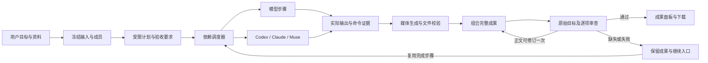

# ModelDesk 协作运行架构

初始调研基线：2026-10-13；自动协作更新：2026-10-18 / 2.10.0。本文说明统一编排层的职责、开源选型和恢复边界；具体可用入口与验收结果以 [功能表](CAPABILITIES.md) 为准。

## 2.11 混合团队与媒体反馈

「协作任务」现在默认复用项目群的自动执行入口。文章、视频、代码模板只是可编辑的角色草稿，不新增模型账户、系统权限或隐藏执行器。原有手动步骤流程仍在「自定义流水线」中使用自己的记录。

执行 Agent 收到冻结成员职责、原始目标、步骤要求和前置实际输出。补充的 Muse 媒体步骤依赖现有计划完成；配图规划接收团队实际正文，并保存画面计划供继续时复用。

`harness/media_evidence.py` 只读取当前项目/任务拥有且摘要匹配的真实媒体。图片生成有界缩略图；视频通过本机 ffprobe 取得时长，通过 ffmpeg 在 10%、50%、90% 位置抽帧。最多八份媒体、十二个画面输入；像素只传给本轮审查模型，不写入日志。运行记录保存文件指纹、画面指纹、输入序号、抽帧时间和检查范围。缺少工具、损坏文件或模型不支持视觉时，不伪装成已看过内容；音轨和全片连续动作不在抽帧证据中。

审查契约可包含 `runtime_revision`，只允许指向已经完成且确认送达的 Muse 步骤。平台先保存唯一修订名额及新步骤，再由原适配器派发。新子任务关联 `revision_of_task_id`，原父任务/项目/群/成员必须一致；不能修订修订任务，不能重发未确认任务，不能借此执行代码或增加权限。断点继续复用该关联任务。修订成功后只把新媒体纳入当前成果，旧文件保留在存储与历史版本；第二次审查仍不通过就交付部分结果及缺失原因。普通正文仍只自动修订一次，整个任务仍受二十分钟预算约束。

## 2.10 项目群自动执行

业务闭环从“用户要交付什么”开始。平台保存目标与背景，统筹模型生成验收要求和分工依赖，执行器把实际结果传给后续成员。正文编辑把这些结果组合为完整交付，审查者同时检查逐项要求与原始目标；可以修正文稿的问题自动修订一次，否则保留部分成果及原因。

| 数据对象 | 保存的内容与责任 |
| --- | --- |
| 原任务 Job | 项目、群、原始要求、成员副本、入口授权、事件；JobManager 是自动任务状态的唯一来源 |
| TaskSpec | 原始目标、验收项、用户明确选择的成果形式和媒体提供方 |
| Frozen inputs | 准备好的上下文、附件描述、系统要求、资料版本与摘要；由原子文件写入独立输入快照 |
| Step / Attempt | 成员、输入要求、依赖、状态、历次尝试、实际输出、子任务引用；不能由模型选择权限或路径 |
| Artifact / Version | 稳定成果标识、完整正文、媒体 ID、内容摘要、版本与修订原因 |
| Review | 每项判断、原始目标是否满足、缺失项、所用模型与版本；机械检查与模型意见分开 |



- `backend/coordination.py` 负责项目群自动闭环；`harness/contracts.py` 定义严格计划/审查结构；`harness/scheduler.py` 负责有界依赖调度；`harness/context.py` 为自动群与既有 LangGraph 模板共用资料版本检查。
- `group_delivery_runtime.py`、`delivery_harness.py` 和现有工具授权继续承担执行适配。不会建立第二套代码或 Muse 执行器。`JobManager` 保存步骤、版本、审查和事件；输入快照只保存不可变输入，不拥有另一个运行状态机。
- `POST /api/groups/{room_id}/messages/{job_id}/continue?project_id=...` 接收 `expected_revision`。服务端校验项目、群、成员、终态、版本、快照、当前容量和剩余预算，然后同步保留继续资格再启动工作。手机入口保留原鉴权，并禁止通过继续获得原生权限。
- 最大八步骤，两项并行。成功分支不因其他分支失败而丢失；失败依赖阻止后继继续使用不完整结果。取消时等待所有已启动协程清理。代码/原生已有任务重新关联而不重新派发，不能保证外部服务取消已经提交的工作。
- 继续时复用已完成步骤和实际媒体；服务重启会记录中断、保守扣除未观察时间，需显式继续。没有把 JSON 文件检查点描述为数据库事务、多机租约或外部系统 exactly-once。
- 审查对照原始目标，防止计划遗漏；最多一次自动正文修订，不把模型的修复建议直接变成新权限或代码执行。版本保留原文、绑定媒体和摘要，前端可展开对照。

原有 LangGraph 模板继续用于显式多阶段协作；2.10 的动态项目群使用上述轻量依赖调度器。两者目前不是一套数据库或一个分布式运行时，后续统一应迁移已有身份与恢复语义，而不是同时维护两份权威状态。

## 2.9 媒体交付层

项目群的自动交付新增 `delivery_harness.py`、`media_providers.py` 与 `delivery_media.py`：将用户的图文/视频要求转换为媒体契约，选择实际具备生成能力的提供方，收集本轮执行 Agent 资源，校验真实字节，最后绑定正文与最终媒体清单。它复用现有 JobManager、固定群成员、任务归属和原生执行边界；不通过聊天文本赋予新的工具权限。

图像能力与聊天模型目录分开验证。OpenAI / Gemini 适配器只有在真实图片通过存储校验后才留下成功记录；Muse 只有当前父任务、群与确认回复匹配的资源才可下载。模型不能以一句“已生成”或编造 URL 满足要求。缺失媒体使任务保留部分状态，不丢弃已经得到的正文。

最终清单中的每份媒体都有任务/项目归属、提供方、模型、大小与 SHA-256。文件私有保存并原子发布，读取核验完整性；ZIP 只打包最终清单中的真实文件，HTML 预览转义不可信内容并使用本地媒体，Markdown 使用可携带的相对路径。具体能力、接口、数量上限与已实测边界见 [图文、视频与媒体 Harness](MULTIMODAL_DELIVERY.md)。

下文描述的 LangGraph 多阶段协作继续负责显式步骤、审阅门槛和恢复；媒体交付层负责当前项目群的图文/视频成品，两层沿用各自持久记录而不重复重放原生任务。

## 为什么需要统一编排

现有 `JobManager` 已负责模型调用、框架子进程、任务事件、停止和结果保存。项目、资料副本、会话历史与工具授权也有明确边界。新的协作运行把这些任务连接起来：一个阶段完成后，下一阶段接收其实际交付；用户可以查看每个阶段、停止运行，并在失败后继续处理未完成阶段。

这里的 **harness** 指执行管理：阶段调度、任务身份、结果传递、恢复和运行记录。模型网关负责供应商连接；Council、CAMEL、CrewAI 和群聊仍负责各自的协作方式。

## 开源选型

本次复用 **LangGraph 的 `StateGraph`**，由 ModelDesk 自己的 `RunStore` 保存父运行与子任务引用。没有启用 LangGraph 原生 checkpointer，也没有把 LangGraph 的全部持久化能力描述成本次已经实现的功能。

| 方案 | 官方能力与许可 | 对本项目的判断 |
| --- | --- | --- |
| [LangGraph](https://github.com/langchain-ai/langgraph) | MIT；Python >= 3.10；图调度、异步节点、状态传递，可选 checkpoint 与 interrupt。 | 已采用图运行时。现有框架可作为节点调用，保留各自执行环境与认证路径；依赖已锁定。 |
| [Deep Agents](https://github.com/langchain-ai/deepagents) | MIT；提供规划、子智能体、文件系统、上下文管理、skills 和工具审阅，构建在 LangGraph 上。 | 适合作为将来的独立智能体适配器。当前直接替换主运行层会重复现有资料、工具和记忆管理，并引入额外模型适配依赖。 |
| [OpenHands Software Agent SDK](https://github.com/OpenHands/software-agent-sdk) | MIT；Python >= 3.12；面向软件开发智能体的 SDK 与工作区能力。 | 适合将来增加隔离的代码执行工作区。现有代码评审不执行项目源码，本轮不因接入编排器而扩大这一边界。 |
| [Microsoft Agent Framework](https://github.com/microsoft/agent-framework) | MIT；Python core >= 3.10；多智能体工作流、handoff、中间件、可观测性。 | 功能完整，但再加入一套 Agent/Message/Tool 抽象的迁移成本较高；本轮只需要已有执行器上方的图调度。 |
| [Pydantic AI durable execution](https://pydantic.dev/docs/ai/capabilities/durable_execution/overview/) / [DBOS](https://github.com/dbos-inc/dbos-transact-py) | Pydantic AI 可接入多种持久执行引擎；DBOS 为 MIT、Python >= 3.10，默认可使用 SQLite。 | 适合需要工作流自动恢复、队列和分布式 worker 的后续部署。当前本机单服务模式采用显式恢复，避免叠加多个持久化引擎。 |

选型依据是与现有代码的组合成本和所需执行语义。以上未采用的框架只是评估候选，不是已安装的功能模块。

## 依赖与兼容性

`pyproject.toml` 指定 `langgraph>=1.2.15,<1.3`，`uv.lock` 锁定 1.2.15 与传递依赖。新增包安装在后端 `.venv`，CAMEL/CrewAI 的独立环境不受此依赖变更影响。运行时不需要 LangSmith 服务或额外模型 API Key。

本机已验证 Python 3.12.13、FastAPI 0.121.3、Pydantic 2.12.4、HTTPX 0.28.1；添加依赖没有升级后三个已有包。实际异步 `StateGraph` 两节点调用和 `uv pip check` 已通过。完整业务恢复、前端与打包验证由项目验收命令执行。

版本与许可证依据：[LangGraph PyPI](https://pypi.org/project/langgraph/)、[LangGraph 包定义](https://github.com/langchain-ai/langgraph/blob/main/libs/langgraph/pyproject.toml)、[Deep Agents 包定义](https://github.com/langchain-ai/deepagents/blob/main/libs/deepagents/pyproject.toml)、[OpenHands 包定义](https://github.com/OpenHands/software-agent-sdk/blob/main/openhands-sdk/pyproject.toml)、[Microsoft core 包定义](https://github.com/microsoft/agent-framework/blob/main/python/packages/core/pyproject.toml)、[DBOS 包定义](https://github.com/dbos-inc/dbos-transact-py/blob/main/pyproject.toml)。安装版本以仓库锁文件为准，远程主分支会继续变化。

## 分层契约

```text
项目、资料与会话
        │
协作运行 API ── RunStore（运行、阶段、子任务引用）
        │
LangGraph StateGraph（阶段调度）
        │
JobManager（已有任务生命周期与事件）
        │
Council / CAMEL / CrewAI / 群聊等执行器
        │
现有模型网关与明确选择的工具
```

- **父运行**记录整体要求、固定的阶段配置与子任务关系，不伪造模型输出。
- **阶段**接收明确的上游交付，保存任务身份与状态。步骤是否完成取决于真实子任务结果。
- **子任务**沿用现有项目、附件、会话和工具检查；跨引擎交付不代表扩大工具授权。
- **RunStore**是协作运行持久状态的唯一依据。LangGraph 用于构造和执行步骤图，重启恢复由应用读取已保存运行记录完成。
- **历史与成果**保留原始子任务来源。失败、取消和部分输出仍明确标记，不能混同于完整交付。

代码分别位于 `backend/harness/models.py`（计划与上限）、`engines.py`（已有引擎适配及交付筛选）、`store.py`（持久记录）、`teams.py`（项目协作组）、`manager.py`（生命周期与图调度）、`router.py`（HTTP 接口）。记录写入 `data/harness`，采用私有文件权限、临时文件替换及文件/目录同步。图执行显式关闭 LangSmith tracing，运行记录保留在本机。

接口以 `/api/harness` 为前缀：模板列表、运行列表/创建、运行详情、取消、继续失败任务、确认阶段和 Markdown/JSON 导出。当前内置三个模板：研究→评审→交付、初稿→改进、讨论→决策；自定义计划最多六个阶段。阶段可以选用八种已有引擎模式；用户确认执行的任意 SDK 脚本不自动纳入协作计划。

每个阶段可选择完成后等待人工审阅。审阅通过后才能进入下一阶段；取消或服务重启不会代替确认。恢复失败阶段需要明确确认可能重新调用该阶段的工具。单阶段最多三次尝试，另有阶段和总运行时间上限。系统不会自动对失败阶段反复调用模型。

创建运行时冻结项目说明与图片/文稿副本。明确选择的知识、记忆和 MCP 配置记录版本摘要；开始阶段和实际读取资料/调用工具时都检查版本，资源读取与检查使用同一存储锁。资料发生修改后需创建新运行，避免同一协作过程悄悄换用不同内容。勾选保存长期记忆时，只在最终阶段保存交付；可选的记忆写入失败显示警告，不把已完成的模型交付改为失败。

## 项目协作组

协作组是可复用的成员配置，不是新的供应商登录方式。每组包含名称、说明和 2–4 位成员；每位成员有稳定标识、名称、模型和职责，组内模型与成员标识分别保持唯一。组保存在 `data/harness/teams`，与运行检查点分开存储。

- `/api/harness/teams` 支持按当前项目列出与创建；`/teams/{id}` 支持读取、修改和归档。未指定项目只表示独立任务范围，不会列出其他项目的协作组。读取、修改、归档与启动都检查项目归属。
- 创建运行可以选择 `team_id`，也可以明确传入临时 `members`，两者不能同时使用。仍支持仅选择模型的快速任务。
- 服务端在启动时读取并复制整个组配置，保存为 `team_snapshot`；运行与子任务记录都保留这份副本。后续修改或归档协作组不会更换已启动任务的成员、职责或重试输入。
- 每个阶段可以选择组内模型的子集；明确配置的原生工作流只能使用本次选择中的模型。每个步骤记录 `participant_models` 和 `participant_policy`，说明实际参与者及适配限制。
- 网关目录用于启动前检查当前模型连接。组配置允许保留尚未接入的模型标识，但包含未接入成员的任务不能启动。目录中出现模型不代表已经完成真实调用验证；Grok 等模型需先在现有网关建立可用连接。

职责由具体执行器接收：并行聊天与群聊把成员分工加入对应模型的系统要求；Council 的独立初答使用各自分工，匿名交叉评审使用共同评审规则，主席综合保留主席职责。自动生成的 CAMEL/CrewAI 工作流把成员名称和职责转换为原生角色与目标；用户明确提供原生工作流时，以该工作流的角色配置为准。

CAMEL 双角色对话默认使用该步骤所选成员中的前两位；较大团队可用群聊、Council、CrewAI 或 Workforce。专门的 CAMEL/CrewAI 代码评审保留固定的代码审查者和证据核查者职责，并在步骤策略中说明；这类评审不会声称使用任意团队分工。模型错误、截断或部分失败（包括代码评审内部引擎结果）不会被当成完整阶段交付继续传递。

## 恢复与重试边界

持久记录必须在启动/等待子任务的边界保存任务引用，恢复时先检查已有任务，避免因浏览器刷新或父运行恢复而重复创建同一阶段。已完成阶段使用保存结果；未完成阶段保留之前的尝试与失败原因。

服务中断后，运行需要显式恢复。恢复是阶段级的：不会声称能够在一个 CAMEL/CrewAI 原生调用的任意内部位置继续。重试也不是对整个多智能体流程做无条件重放。外部工具若已经产生副作用，数据库记录本身不能提供跨外部系统的 exactly-once 保证。

已用时间随运行检查点保存；服务意外中断后，未观察到的时间按保守方式计入剩余预算。加载历史会验证记录结构，损坏记录不应阻止其他项目启动。

LangGraph 原生 checkpoint 可以保存每个 super-step 的图状态，并保存同一步骤中已经完成节点的 pending writes；其 `interrupt()` 恢复会从所在节点开头重新执行。因此，即使将来采用原生 checkpoint，也必须把有副作用的调用与等待输入分开，保留稳定任务身份和去重规则。[Checkpointers](https://docs.langchain.com/oss/python/langgraph/checkpointers)、[Interrupts](https://docs.langchain.com/oss/python/langgraph/interrupts)

## 2.12 任务连续性与媒体恢复

群聊历史不再只收集成功成果：同项目同群的失败或取消任务保留用户要求，部分正文标记为未完成草稿，原始错误日志不作为成果注入。`context_mode=fresh` 写入持久边界，后续继续只使用该边界之后的记录；当前要求优先，显式项目资料和工具许可保持独立。

执行交接与审查摘要分开：审查可以使用有截断标记的摘要，原生 Agent 接收完整的直接依赖输出，并记录指纹和长度。超过执行器输入上限时明确阻止派发。Muse 同一任务内先生成图片再制作视频，不能等待一个位于自身执行之后的独立图片阶段。

视频验收保留时长上下限、音轨和字幕要求。媒体读取验证范围与 SHA-256 后，实际时长和音轨存在性参与机械检查；字幕、旁白内容和全片同步不能由音轨存在或少量抽帧推断。已确认 Muse 任务缺少文件或未达到机械条件时，可以安排一次有明确来源的修订。仅修订图片时保留已有视频，未知送达状态不重发。

长视频生成采用有界的独立等待预算：Muse 单次最多观察30分钟，含视频的群任务累计最多60分钟，其他群任务仍为20分钟；继续次数仍最多两次。超时只结束本地等待，不能声称外部任务已停止。重启和继续复用同一子任务身份，不重新生成。

## 后续扩展条件

1. 需要并行阶段、动态分支或更复杂循环时，扩展图与阶段契约，并先补齐取消、部分失败、依赖交付和预算验证。
2. 需要多进程/多机器 worker 时，迁移到支持事务和抢占租约的运行存储；不能依赖单进程任务字典实现分布式调度。
3. 如果采用 LangGraph `AsyncSqliteSaver` 或 Postgres checkpointer，应制定迁移方案并明确谁是恢复状态的唯一来源，避免和 RunStore 同时维护相互冲突的检查点。[官方持久化指南](https://docs.langchain.com/oss/python/langgraph/persistence)
4. 增加 OpenHands、Deep Agents 或其他执行器时，仍需通过统一的项目范围、资料来源、工具许可、产物和取消契约。源码写入与命令执行需要独立工作区能力，不能由聊天模式隐式获得。
5. 增加自动重试时，按具体传输错误、预算和工具幂等性决定策略；避免 SDK 内部重试与图节点重试相乘。[LangGraph 节点重试](https://docs.langchain.com/oss/python/langgraph/use-graph-api)、[Pydantic AI/DBOS 重试说明](https://pydantic.dev/docs/ai/capabilities/durable_execution/dbos/)

可回放的执行过程和实际任务结果是验收依据；仅引入框架、绘制流程图或保存配置不证明端到端协作已经完成。
