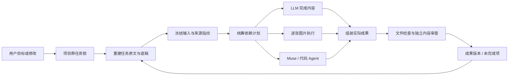

# ModelDesk 2.14.1 — Task continuity / 连续任务记忆

## 问题与业务行为

一次任务从原始目标开始，用户可持续修订。团队在同一任务内继承原始要求、按时间追加的修改、最近底稿和实际素材。新消息不等于新任务；失败也不等于清空任务。只有用户选择“开始新任务”才建立新的边界。

2026-10-28 的真实文章记录显示两个不同问题：

- `76738eb1…` 与 `be64aa12…` 已引用旧文章，但七章配图计划被“四张图片”限制拒绝。初稿还曾为满足默认两张图而把七章改成一个主章节。
- 历史输出共用 16,000 字符窗口，长文章可挤出原始要求；规划与文字步骤另截取 18,000 字符，原生执行交接则只包含最新一句话与直接前置结果。最终编辑和审查也只看到最新一句话作为目标。

本版修复这些路径，没有引入第二套 Agent 运行器或改变现有登录、审批权限。

## 数据对象

| 对象 | 内容与约束 |
| --- | --- |
| Task context | `task_id`、项目/群作用域、修订号、按时间排列的用户原文、最近成果、必要时的最近完整底稿、素材引用、冻结附件文本及 SHA-256。相同连续重试合并文字，保留全部来源任务 ID。 |
| Input snapshot | 随任务保存的实际提示词、任务上下文、团队、Skills、附件与资源版本；续做仍校验原指纹。 |
| Handoff | 用户要求、当前成员职责、完整前置定稿、真实素材映射、实际派发内容和哈希。可以压缩重复背景，不能静默裁掉用户要求和直接前置定稿。 |
| Image slot | 每张图独立的用途、提示词、模型、尝试记录和实际文件。断点续做校验已保存文件，只生成未完成位置。 |
| Reused media | 统筹从当前任务素材中明确选择；平台检查原项目/群及文件哈希，保存本轮私有副本与来源。复用不等于新生成。 |

## 数据流与架构

`task_context.py` 管理上下文重建和素材复用；`coordination.py` 继续承担规划、依赖执行与验收；`task_handoff.py` 准备可追溯交接；`role_images.py` 保存逐张图片任务。原 JobManager 仍是唯一任务记录存储。

聊天轮数只控制讨论引用窗口。任务记忆独立于该窗口，原始要求不会因为连续失败或长回复被挤出。持久上下文超过 60,000 字符会在执行前明确停止，提示拆分，而不是静默删除要求。原生 Agent 的硬性长度、未知状态不重发、代码合入审批继续生效。

“按要求自动”的图片数是缺省建议，不能覆盖“每章一图”等具体要求。总媒体预算为 12 份/200 MB；实际生成逐张保存，图片清单按用途分别编写。界面使用任务实际需求作为进度分母。

## 验证范围

- 回归覆盖：长文章与 1 轮历史窗口、连续失败、重启重建、跨项目/群隔离、新任务边界、失败修改保留完整底稿、附件删除后的冻结副本、原生交接原文、超长定稿不裁切、媒体来源校验、七张图片第 3 张失败后续做。
- UI 检查：实际浏览器查看任务记忆，修复输入区裁切浮层，改为可滚动原生对话框；媒体进度按真实需求显示。
- 真实文章重跑沿用用户原来的 GPT / Gemini / Claude / gpt-image-2.5 团队；聊天历史设置为 1 轮，任务原始要求与底稿独立保存。验收记录保存在本地 `data/acceptance-214/`，不提交私人正文和图片到 Git。
- 10 月 28 日因锁屏暂缓的 Muse 原生实测已在 10 月 29 日补做，记录见下文。没有把测试替身或旧视频记作新的 Muse 视频实测。

### 真实续做结果

任务 `709f98be-ae25-49ad-8912-7024903e57e6` 使用原来的四角色团队完成了这次补图：GPT 创作、Gemini 审查、gpt-image-2.5 绘图、Claude 排版。最近聊天仅引用 1 轮，任务记忆仍保留原始要求与修改前底稿。

- 复用并校验 2 张既有图片；逐章生成 7 张新图，共 9 个真实 PNG，七个章节均嵌入对应图片，保留完整 20 条实践。
- 第 3 张图片曾超时，平台如实保留部分成果。重启服务后续做一次，前 2 张新图、2 张复用图与已完成文字步骤均未重做，只补齐后 5 张并继续排版。
- 最终四个步骤完成，文件检查 9/9，独立 Gemini 审查通过。上游超时仍可能发生；本记录证明的是此次恢复与交付路径，不是所有模型永远可用。
- 服务重启按当前图文或视频任务预算保留已耗时间；不会退回旧的固定 1,200 秒计数而重新授予已消耗的额度。
- 图文成果包提供独立 HTML、Markdown 和 9 个原图，离线相对链接可用。页面使用 remark-gfm，离线预览使用 markdown-it-py 解析表格与列表；仅允许包内已校验媒体，原始 HTML 不执行。图片下载链接不再被重复渲染为第二张图片。

文件存在、可下载、模型内容审查与用户最终认可仍是不同证据层级。本文不声称所有上游服务、所有内容或长视频质量已获得全面保证。

### Muse 跨轮交接与成片验收（2026-10-29）

在独立验收群中，第一轮只让 GPT 编剧整理规格，第二轮只要求“按上一轮确认的完整规格”自动制作。聊天引用窗口为 1 轮，原始目标与修改分别保存在任务记忆中；旧的琥珀色小球视频被新任务边界隔离。

- 第一轮 `4fd8d114-e5a6-4f9c-997f-a719c5f11012`；执行轮 `2f57f2a3-7893-4cf2-abd1-098a21e5860f`。GPT 编剧与统筹完成交接，Muse 实际制作，Gemini 参与审查，统筹整理真实成果。
- Muse 任务 `3ea60ed5-230d-4a2c-b254-5400667b6754` 收到完整 4,319 字符交接，保留两轮用户原文、前置定稿与上下文指纹。绑定的 Lemo-Opuscar 固定版本被转换为 5,120 字符的创作指引；来源与指引哈希均保存。这是指引传递，不代表在 Muse 中安装上游渲染器。
- 新产物为 6.000 秒、1280×720、30 fps、180 帧的 H.264 MP4，无音频流。文件 SHA-256 为 `95c4ec48e8c2c1e3a911eb0e262cf386c9fffc02bebdca2454d5a8d27dae0507`，25,661 字节；与此前验收的视频不同。
- 平台保存、播放入口与单文件下载可用，ZIP 含 HTML、Markdown、清单和真实 MP4。完整解码 180 帧，并额外检查蓝色小球在所有帧中向右移动、尺寸稳定、背景无额外元素；这些逐帧检查属于本次发布验收，不冒称为平台通用的视频理解能力。

### 2.14.1：防止验收理由与通过状态矛盾

上述真实运行暴露出一个问题：审查模型给出 `met=true`，理由却明确写“尚未验证全片连续动作”。2.14.1 为每项新审查强制要求 `evidence_status`（已核实、有限、未核实）；缺少这个字段会先请求一次结构修复，仍不合格则保留成果并明确检查未完成。有限或未核实的验收项不能计作通过；原理由保留给用户查看。历史已保存报告保持原样，不伪造追溯验收。

若只缺少检查证据，平台保留实际视频与已完成步骤，不通过重写正文或重发 Muse 来假装补齐证据。该约束不能替代连续音画、人物一致性或外部事实的实际核验；模型仍可能错误判断证据覆盖范围。回归用例覆盖缺少字段的结构修复、有限证据、真实披露说明与禁止重复派发原生任务。

复核还发现：已选择复用完整视频后，补齐原生媒体的逻辑仍按总需求寻找 Muse，导致多余的“缺少 Muse 成员”提示，甚至可能追加创作。现在先扣除已经校验并复制的素材，只为剩余缺口寻找执行器；验收总量保持不变。测试同时覆盖团队有 Muse 和没有 Muse 的复用情形。

修复后的真实复核 `38e9ef68-b6b9-4c4a-bbbe-9ec716007104` 只选择两名 LLM，复用了同一 MP4，未新增 Muse 任务，也没有再出现缺少 Muse 的错误提示。文件检查通过；三个需要全片证据的条件保持有限证据状态，真实披露说明正常通过。成果保留播放和下载入口，内容验收按实际证据标为待完成。
