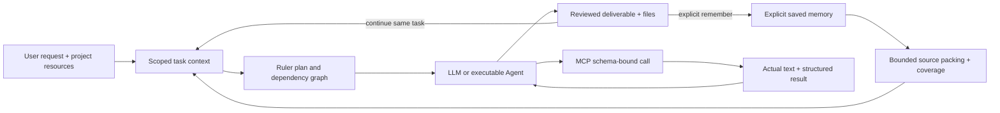

# ModelDesk 2.18 — Context, memory and MCP reliability

## Business flow

A user defines an outcome, the team assigns roles, and each member receives the current requirements plus its actual upstream outputs. The final deliverable is reviewed and exported. Continuing a task must retain those requirements, preserve incomplete work honestly, and avoid repeating an external action merely because its result is large or its connection was interrupted.

This release fixes observed failure modes within the existing runtime. It does not add another agent server or claim unlimited memory.

## Data objects and flow

- **Task context**: project + room + task boundary, ordered user requests, latest draft, last complete baseline, verified media and document preferences. Identical draft/baseline bodies now use a hash-bound `content_ref`; each retains its own job, status and provenance. Only exact content is deduplicated.
- **Saved result memory**: explicit user opt-in produces a valid `modeldesk.result-memory.v1` JSON record, including the full request, final content/result, completion state, limitations and sources. Group discussion is excluded. The existing resource limit is 2,000,000 characters; exceeding it reports a save warning without corrupting the result.
- **Working context**: selected memories precede automatic retrieval. The existing 8,000-character resource-context budget now includes serialization overhead. Each source reports available/included characters, full-source and excerpt hashes, and omitted/partial status. Full saved memory is retained independently of what fits in one prompt. BM25/jieba retrieval remains the local search engine.
- **MCP contract and receipt**: all tool-list pages are collected before selection/dispatch. The adapter freezes input/output schemas and validates returned structured output; text and structured data are retained together. Independent Agent receipts keep existing no-replay semantics.

The same-task direct tool loop also retains complete bounded JSON for MCP and memory results. An identical MCP call is not dispatched again after a typed `retryable:false` response. This local loop guard is not a replacement for the independent Agent's durable receipt. Unrelated calls remain allowed.

## Concrete repairs

1. A 35,000-character complete article followed by a partial document-export retry previously duplicated the same body and exceeded the 60,000-character task-context limit. Exact body aliasing resolves that case; different bodies still count separately.
2. An explicitly selected 5,000-character memory was silently cut to 3,000 while `truncated` remained false. Actual coverage is now reported and the full entry can fit when within the overall budget.
3. Saved memories formerly sliced serialized results at 12,000 characters. Limitations and sources at the end could disappear. New saved records retain valid complete content and expose partial status with retrieved excerpts.
4. MCP discovery formerly stopped at page one. MCP text could suppress `structuredContent`, and another tool-history slice could cut otherwise valid JSON. These paths now preserve bounded results or return an explicit oversized-output error.
5. Failed source reads previously looked like empty lists; stale project selections could remain hidden. Loading/error/retry and removable missing selections are now explicit. MCP member configuration checks current permissions and required argument compatibility before saving.
6. The task-memory panel now labels the prior execution snapshot accurately; it does not imply that snapshot already contains the output produced afterward.

## Research and reuse decisions

| Primary source | Applicable lesson | Decision here |
| --- | --- | --- |
| [Deep Agents](https://github.com/langchain-ai/deepagents) ([MIT license](https://github.com/langchain-ai/deepagents/blob/main/LICENSE)) | Isolated subagents, explicit filesystem outputs and managed context | Keep existing typed artifacts, task graph and runtime; do not add a second orchestration layer solely for these fixes. |
| [LangGraph memory](https://docs.langchain.com/oss/python/langgraph/memory) | Distinguish per-thread state from longer-lived scoped stores | Preserve existing LangGraph support, separate task ledger and explicit resource memory. |
| [MemGPT](https://arxiv.org/abs/2310.08560), [Letta memory blocks](https://docs.letta.com/v1-sdk/memory/memory-blocks) | Working context differs from durable backing storage | Keep full results in local storage and expose bounded, attributed excerpts. No Letta server dependency added. |
| [LongMemEval](https://arxiv.org/abs/2410.10813), [official repository](https://github.com/xiaowu0162/LongMemEval) | Evaluate updates, temporal state and cross-session recall separately | Add regression cases for changed drafts, failed continuation, exact duplicates and task/project isolation. This is not a run of the LongMemEval benchmark. |
| [Anthropic long-running harnesses](https://www.anthropic.com/research/effective-harnesses-for-long-running-agents) | Persist concrete progress and artifacts across sessions | Retain versioned results and incomplete status rather than relying on conversation summaries alone. |
| [MCP pagination](https://modelcontextprotocol.io/specification/2025-11-25/server/utilities/pagination), [structured output](https://modelcontextprotocol.io/specification/2025-11-25/server/tools#structured-content) | Catalog completeness and output contracts are protocol responsibilities | Reuse the installed official MCP Python SDK; implement shared bounded pagination and validation. See [MCP contracts](MCP_RELIABILITY.md). |

No third-party implementation was copied in this release. Existing dependencies remain; the research informs the project-specific fixes and regression criteria.

## Validation and limits

Automated checks cover backend, UI state, lint and desktop runtime. The actual local HTTP MCP fixture tests a tool on page two, both text and structured output, output-schema capture, and one actual dispatch even when the saved result is read again.

Live acceptance uses GPT author → local MCP statistics Agent → Gemini reviewer over two turns, with real Word/PDF/HTML downloads and full saved-memory readback. A marker beyond the former 3,000-character cut must survive the first result and a later color-only edit. Acceptance records and generated files are local under `data/acceptance-218/`, excluded from Git.

MCP currently supports bounded synchronous text/structured results, not arbitrary asynchronous tasks, elicitation, or media-resource ingestion. Task-context and native handoff limits still apply. This release does not revalidate Muse cloud creation or imply every external Agent is always available. Native Muse draft focus and readback remain a separate integration issue recorded in 2.17 acceptance.
