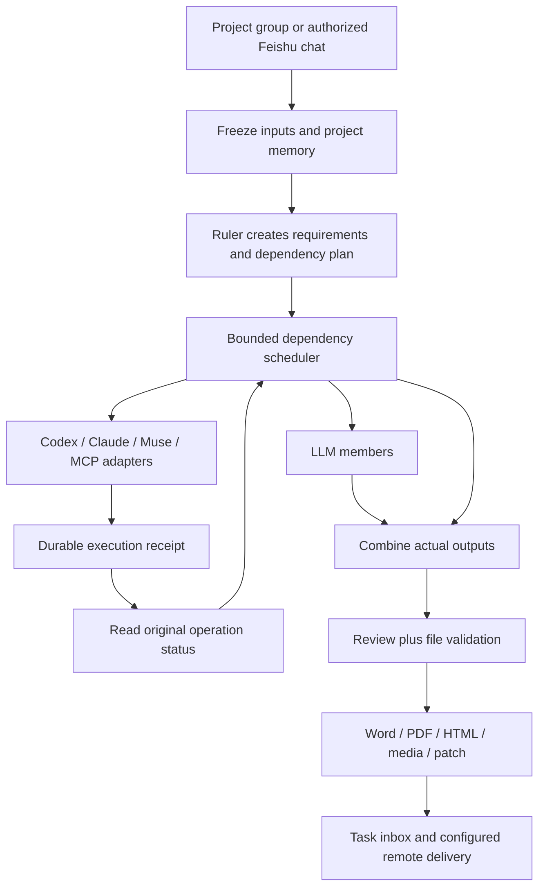

# ModelDesk 2.21: durable collaboration and real deliverables

## Business flow

A user selects a project and team, describes the desired deliverable, and can
leave the task page. The platform freezes the original request, project rules,
role configuration and available tools before planning work. Members receive
the actual output of their prerequisites. A temporarily failed model step can
recover; a downstream Agent that has never been dispatched can then start under
the original permission scope. An external operation with an uncertain outcome
is never submitted again by recovery.

Completion means that the current deliverable has passed its checks and the
requested files can be read back. A plan, remote task identifier, generation
message, or a cancellation acknowledgement is not completion.

## Data and ownership

| Object | Ownership and invariant |
| --- | --- |
| Project memory | User-authored constraint or confirmed decision; project ID, full content, revision and hash; optional pin; previous versions retained. |
| Frozen task inputs | The task's original project memory and selected resources; editing a rule affects later submissions, not active tasks. |
| Delivery step | Frozen member, dependencies, instruction and attempt ledger. An empty ledger alone is insufficient: room, permissions and child receipts are checked before an initial dispatch. |
| External task receipt | One dispatch identity, remote task ID, server/schema/prompt fingerprints, observed status, next polling time and actual output hash. |
| User response | Request version and response hash recorded before transmission. An uncertain response is not automatically resent. |
| Deliverable | Reviewed content, verified media and requested Word/PDF/HTML files, each tied to actual bytes. |

Fixed project memories are limited to 20 entries and 8000 characters in total.
They bypass excerpt selection and are included in full. Ordinary reference
memories still use the existing explicit context selection and read-range
reporting. Imports create a new current resource with its own version history;
they do not restore another installation's edit history.

## Runtime architecture



`project_memory.py` owns pinned snapshots; `platform_store.py` owns edits and
version history. `coordination.py` and `operation_recovery.py` distinguish first
dispatch from result collection. `mcp_tasks.py` implements the protocol envelope;
`mcp_observation.py` owns polling and explicit input/cancellation actions.
`feishu_supervision.py` reserves reconnect attempts durably before launching a
replacement receiver. These extend the existing supervisor rather than adding
a second execution queue.

## MCP long-running task contract

The adapter follows the official [MCP Tasks extension specification, 2026-07-28](https://tasks.extensions.modelcontextprotocol.io/specification/2026-07-28/tasks).
The service must advertise `io.modelcontextprotocol/tasks` through
`server/discover`. Requests advertise client extension support, use the flat
task result shape, and send the required `Mcp-Method` / `Mcp-Name` HTTP headers.
Ordinary synchronous MCP services remain supported.

- A `tools/call` receipt is persisted before the parent waits.
- `tasks/get` observes the same task after transport loss or restart, respecting
  the server's polling interval and TTL, with a local 24-hour observation cap.
- `input_required` exposes supported primitive form fields. The user answers or
  declines; the platform does not automatically grant permissions or open URLs.
- `tasks/update` and `tasks/cancel` save intent before sending. A cancel receipt
  means the request was accepted; only a later terminal remote state establishes
  that execution stopped.
- Actual output is checked against the frozen tool output schema before handoff.
  This extension does not turn arbitrary remote media descriptions into files.

## Defects resolved during acceptance

- The code reviewer previously received patch metadata without the patch. The
  adapter now reads the verified patch, includes up to 24,000 characters, and
  explicitly labels truncation or sensitive-content redaction.
- An explicit image model's temporary HTTP server failure could leave an
  otherwise completed article without its second image. Explicit HTTP
  429/500/502/503/504 responses now permit at most two requests to the same
  provider/model. Transport uncertainty is not treated as an explicit rejection.
  Each attempt is recorded; previously generated images remain available.
- Muse's WebKit editor converted some ASCII quotes in task JSON. The native
  bridge temporarily suspends Smart Quotes through the editor's actual context
  menu, restores the previous setting, and performs exact clipboard readback.
  It does not normalize away changed requirements. A confirmed unsent draft can
  be manually resumed only if its original request marker and saved fingerprint
  still match; changed or unrelated drafts are not overwritten.
- Feishu receiver process failure now has a persistent reconnect budget: three
  attempts per configuration revision in 15 minutes, with backoff. Existing
  incoming/outgoing deduplication records survive receiver replacement.
- Muse video attachments presented behind an "Open animated video" preview are
  now collected using the preview's real download control and native save panel.
  Collection observes the existing conversation and never resubmits generation.
- Video review now receives up to twelve timestamped frames and bounded full-frame
  decode/change statistics. Sampling and pixel change do not establish full-film
  semantic review, identity continuity, audio content or audio/video synchronization.
- HTML exports embed verified video bytes in a native player, with no network
  dependency or scripts. Total embedded media is capped at 50 MB; oversized
  exports explicitly direct users to the media bundle. Word/PDF retain the
  separate-video explanation. Unverified or foreign media is never embedded.
- Feishu accepts mobile textual rich posts without discarding their text or
  links. Unsupported attachments receive an explicit rejection rather than a
  silent partial task. Whitespace between command words is handled consistently.
  Routing diagnostics show why a message was not accepted without saving the
  text of ignored or unbound messages.

## One Feishu bot, multiple project groups

Configure the application credentials once. Each authorized Feishu chat binds
to one ModelDesk project group; add or change a binding for a new group rather
than creating another bot. Sender restrictions and native-Agent permissions
remain separate for every binding.

The optional **直接用自然语言派发任务** setting lets an authorized chat send a
plain-language request as a fresh task. **继续：修改要求** explicitly carries the
group's context into a revision. Greetings show help; they do not create jobs.
Group chats still require mentioning the actual bot. Existing installations
remain command-only until this option is enabled. `/modeldesk task`,
`/modeldesk continue`, `status` and `cancel` remain available. Previously ignored
messages are never replayed automatically when this setting changes.

## Reproducible checks

```bash
.venv/bin/python scripts/verify_modeldesk.py
.venv/bin/python -m unittest backend.test_mcp_tasks_http -v
.venv/bin/python scripts/package_modeldesk.py
```

Real provider acceptance is explicit and creates isolated labeled projects. It
can consume the configured providers' credits; collection never submits again.

```bash
.venv/bin/python scripts/evaluate_automation.py --submit article --output data/new-article-acceptance
.venv/bin/python scripts/evaluate_automation.py --collect --output data/new-article-acceptance
```

Replace `article` with `video` or `code` for their workflows. Do not reuse an
existing output directory to submit another task. The code fixture lives only
inside that directory; verification applies the patch in a separate temporary
copy and confirms the original fixture remains unchanged.

## Current acceptance evidence

- **Illustrated article:** GPT author, explicit `gpt-image-2.5` image member and
  Gemini reviewer produced two actual images and Word, PDF and standalone HTML.
  Download hashes and embedded image counts passed. Recovery preserved the
  first image and completed the missing second image.
- **Revision and memory:** editing the pin through the UI created revision 2;
  a short follow-up retained both image hashes and all three file formats,
  included the new requirement, and left the original job's revision 1 intact.
- **Code and independent review:** Codex produced a real patch and ran tests;
  the downstream reviewer received the actual diff. Independent application of
  that patch passed ten boundary cases; the original fixture remained clean.
- **MCP protocol:** a real local HTTP transport test with the official SDK
  reinitializes and observes the same deferred task across three sessions while
  asserting exactly one `tools/call`. Deterministic tests cover input replies,
  uncertainty, expiry, mismatched IDs, cancellation and malformed results.
- **Muse video:** an actual 75-second, 1280×720 MP4 was collected from the native
  conversation. Download hashes and full decode of 1800 frames passed. A follow-up
  reused the exact same video hash, retained project rules, and exported HTML
  plus the separate playable MP4 without another Muse generation. The original
  incomplete run remains visible as history; it was not rewritten as successful.
- **Feishu:** a real iPhone plain-language message created one fresh task. The
  author and independent reviewer produced matching Word/PDF/HTML files without
  images or video. Download hashes, readable document contents, and all nine
  outgoing acknowledgement/upload/message receipts passed. The user confirmed
  receipt of all files and normal PDF display on the phone. Separate tests verify
  one bot routes two allowed chats to different project groups, receiver restart,
  command and natural-language scope, rejection replies and deduplication.

Local evidence is in `data/acceptance-221/` and is intentionally excluded from
Git, along with credentials and generated media. The application remains a
single-Mac platform: the Mac must be awake and online, and native Muse actions
need an unlocked usable desktop. A third-party Agent must provide a supported
adapter or protocol; adding a role name does not create that capability.
