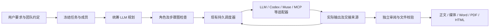

# ModelDesk 2.23：角色约定、实际交接与代码交付

## 检查结论

ModelDesk 已具备项目级多模型与执行 Agent 协作能力。本次改进重点是让用户定义的分工成为可检查的执行约束：必须参与的角色不能被规划器省略，下游不能越过前置工作，代码交付必须对应实际目标文件。它仍是有明确执行器、权限和容量边界的平台，不能把任意应用名称当作已经接入的 Agent。

检查覆盖团队配置 UI、模型目录加载、团队持久化、计划解析、调度、角色上下文、Codex 工作区、成果审阅和文件下载。实际运行选用 GPT → Codex → Gemini；Muse、Claude Code 和 MCP 的新契约行为通过自动化测试覆盖，本轮没有重新触发这些外部运行时的真实创作任务。

## 业务逻辑与操作

1. **定义团队**：在「Agent 与连接 → 项目 Agent → 成员与分工」设置统筹 LLM，并为每个角色选择 LLM、绘图模型、Codex、Claude Code、Muse 或 MCP。角色名称是职责，成员类型是实际执行能力，两者分开保存。
2. **定义交接**：展开角色的「自动协作约定」，设置是否必须参与、应交付什么、先接收哪些角色的成果。例如「需求分析 → Codex 工程师 → 独立审阅」。上方「角色与交接」显示整个关系；Skills 保留在按需展开的设置中。
3. **发起任务**：保存团队并创建项目群，已有群需要应用新成员设置。使用「自动完成」交代完整成果要求。统筹者规划实际步骤，服务端先检查用户约定，再允许执行。
4. **查看结果**：最终正文和文件仍在成果面板；「验收与素材 → 角色参与与交接」列出本轮分配、前置角色和交付约定。代码可从补丁面板独立审查，合入仍需原有审批。

“必须参与”只约束本轮选中的成员。点名一个角色时，如果没有同时选中它的前置角色，平台明确要求调整选择，不会悄悄调用未选的 Muse 或 MCP 工具。普通讨论和手动 Agent 派发不应用自动调度约定。旧流水线不支持这些约定，会提示改用项目群，而不是静默忽略。

## 检查发现与修复

| 环节 | 发现 | 本次处理 |
| --- | --- | --- |
| 角色配置 | 职责只有自由文本，无法明确哪些成员必须做实际工作 | 新增 `required`、`after_member_ids`、`expected_output`；服务端保存和执行都检查 |
| 交接顺序 | 规划器可能漏掉用户期望的前置角色，或把审阅排在实现之前 | 将角色关系编译为步骤依赖；拒绝缺失角色、未知前置关系和组合后的循环 |
| 上下文 | 角色交付要求没有独立的持久字段 | 约定进入冻结团队、角色输入及其摘要、执行证据和最终审阅材料 |
| 历史复制 | 从旧任务复制团队时丢失明确选定的统筹模型 | 同时复制 `coordinator_model` 与成员约定，保留用户选择 |
| 加载状态 | 目录或群成员尚未读完时可能显示“未接入”“没有 LLM” | 等对应数据到达后再判断，不把加载中误报为配置缺失 |
| 代码交付 | 实测中 Agent 在隔离区内再建副本，测试通过但平台审批补丁没有直接修改目标 | 明确工作目录已是平台隔离副本；规划器、执行器、最终审阅者共同核对真实相对路径 |
| 文件呈现 | CLI 返回的相对文件路径被当成网页链接，点击会访问不存在的应用路由 | 在时间线、代码 Agent 页、执行结果面板标为工作区文件；真实下载仍从成果或补丁面板打开 |

## 数据对象与流转

```json
{
  "id": "builder",
  "name": "工程师",
  "kind": "codex",
  "required": true,
  "after_member_ids": ["planner"],
  "expected_output": "修改目标文件，返回实际补丁和测试记录"
}
```

- **团队与任务快照**：用户保存角色约定。任务开始时冻结成员和统筹配置；之后编辑团队不改写历史任务。
- **执行计划**：统筹 LLM 产生步骤；确定性检查要求必选成员有实际步骤，并把前置角色的全部步骤加入依赖。保存的角色图与最终步骤图都必须无环。
- **角色输入**：原始目标、后续要求、任务要求、上游真实输出及用户保存的交付约定一起进入角色输入；摘要用于追溯来源，不表示模型已经理解。
- **执行证据**：每步记录真实输出、文件、补丁、命令与状态。最终编辑和审阅收到相同的角色约定与证据。
- **最终成果**：正文、媒体、文档保持现有独立校验及版本机制。角色约定本身不会把任务自动标成通过，也不会授予新工具权限。



职责集中在 `backend/role_contracts.py`；复用现有调度器、隔离工作区、恢复记录和输出适配器，没有再引入另一套相互竞争的任务状态机。新字段为空时保留原来的成员序列化结构，以兼容旧任务的快照比较。

## 本轮验收

1. **团队配置：通过。** 浏览器实际编辑保存，再刷新、重选团队回读相同交付约定；构造循环时保存被拒绝。键盘 Enter 可展开约定。1280×720 桌面及 390×844 窄屏检查中，角色概览和表单均可读，字段没有横向裁切。未进行完整屏幕阅读器审计。
2. **真实协作：通过。** GPT 制定条件，Codex 修改 `duration.py` 并增加测试，Gemini 在其完成后收到实际补丁和命令记录，最终生成可下载 HTML。三个必须参与的角色均有步骤，直接依赖和角色输入来源一致。
3. **实际代码交付：通过补丁复验。** 首轮发现嵌套副本问题后修正并重跑。第二轮平台收集的补丁直接修改目标文件；把该补丁应用到新的干净副本后，4 个测试方法、36 组输入通过。原项目摘要未变，没有合并、提交或推送验收项目的代码。
4. **回归检查。** 发布前运行 `scripts/verify_modeldesk.py`，覆盖后端、前端与桌面；使用 `scripts/package_modeldesk.py` 构建实际 macOS 应用并检查签名。精确计数以发布运行日志为准。

本地复核资料位于忽略目录 `data/acceptance-223/`：前后截图、首次问题记录、修复后的真实任务、平台补丁、独立补丁复验记录和导出的 HTML。该目录含本机运行路径，不提交 GitHub。首次运行记录保留用于说明缺陷，不作为代码交付通过证据。

## 研究依据与取舍

| 一手资料 | 采用的思路 | 本次落地 |
| --- | --- | --- |
| [Why Do Multi-Agent LLM Systems Fail?](https://arxiv.org/abs/2503.13657) | 失败不仅来自模型能力，也来自系统设计、Agent 间协作和验证 | 把角色参与、依赖与真实成果分开检查 |
| [Anthropic: Effective harnesses for long-running agents](https://www.anthropic.com/research/effective-harnesses-for-long-running-agents) | 长任务需要持续进度、明确工作环境和成果检查 | 复用持久任务与冻结交接，明确代码工作区身份，以实际补丁复验 |
| [LangGraph persistence](https://docs.langchain.com/oss/python/langgraph/persistence) | 线程检查点与跨任务记忆属于不同范围 | 延续任务快照和项目记忆边界，团队修改不重写历史 |
| [LangGraph Supervisor README](https://github.com/langchain-ai/langgraph-supervisor-py/blob/main/README.md) | README 建议直接通过工具实现 supervisor，以便控制上下文 | 沿用当前适配器和状态机；本次检查时该仓库已归档，没有新增其依赖 |
| [OpenHands Software Agent SDK](https://github.com/OpenHands/software-agent-sdk/blob/main/README.md) | 分离模型、Agent、工具、会话与执行环境 | 将角色约定作为独立对象，保留执行器和工作区职责 |

这些是设计参考，没有复制上述项目代码，也没有将接入某个开源框架等同于所有任务可成功。

## 仍需区分的能力边界

- 统筹者当前必须是具有文字推理能力的 LLM；执行角色可以由各类已接入 Agent 担任。每组仍为 2–4 名成员，并发步骤上限保持现有设置。
- `expected_output` 是会传入执行及审阅的用户约定，不是适用于任意产物的形式化正确性证明。代码补丁复验本轮由验收流程执行，并非所有用户任务都会自动重复运行代码。
- 当前本机 Codex 已通过真实执行；检查时 Claude Code 提示需要登录，Muse 提示需要打开聊天输入框。此版本没有绕过它们的运行前置条件。
- 不确定是否已派发的外部任务继续保留“不重复发送”规则。自动协作可以后台运行，但本机执行仍依赖 Mac 唤醒、联网和所需运行时可用。
- 下一步适合以已验证的执行基础扩展：按文件绑定可执行验收条件、统一外部 Agent 的能力声明、按任务维度统计交付成功率。它们不计入本版本已实现功能。
