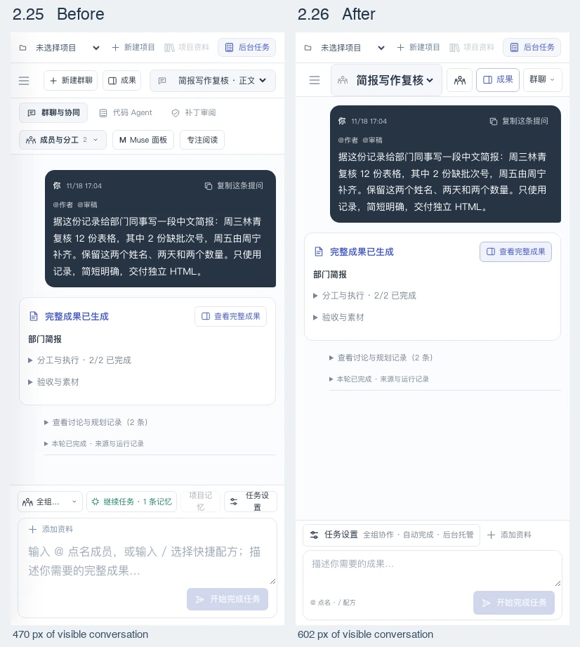

# ModelDesk 2.26 工作台体验审查

用户把工作交给团队后，能否离开屏幕，回来找到同一个任务和可用的成品？这次审查覆盖项目群、单项协作、自动协作和自定义流水线、项目资料和代码审查、看板、模型与 Agent 设置、项目资源、后台任务和手机配对入口。检查使用原有界面、受控样例、实际服务接口及两种真实模型。初次使用者的学习时间还需要观察测量。

## 从派发到交付

| 维度 | 用户遇到的问题 | 2.26 的行为与验证 |
| --- | --- | --- |
| 信息架构 | 从提示词库新建会话，页面已换，侧栏还停在资源。某些路径同时高亮两个目的地。 | 当前工作区统一决定侧栏与子导航。进入项目资源会恢复上次分类。旧版错误可用三次点击复现。 |
| 用户流程 | 手机打开任务看板后缺少返回导航的入口。键盘在弹窗外仍能移动。 | 看板可直接打开导航。导航关闭后还原焦点。命令搜索、项目资料和文件夹选择支持键盘、Escape 与焦点返回。 |
| 操作效率 | 群聊的固定工具与默认成果栏占用阅读空间。快捷搜索截断了较早的项目和会话。 | 群聊保留一行标题。成员、附件和任务设置仍可直接访问。成果从消息或快捷键打开。搜索覆盖已加载的项目和当前项目会话。 |
| 反馈机制 | 网络断开时，用户无法判断任务是否已派发。工具目录读取失败也可能表现为空白。 | 群聊讨论和自动完成按房间保存发送回执。重试返回原任务，编辑中的新草稿可继续。内置工具、MCP 和原版应用分别显示加载、空清单及可重试错误。 |
| 视觉层次 | 390 像素宽手机的可读对话仅有 470 像素高。深色主题中，展开的用户消息正文几乎融入背景。 | 同一消息在同尺寸下得到 602 像素可读高度。在两种主题分别检查 14 项消息元素，正文、引用、表头、链接及操作文字均达到 4.5∶1。 |
| 组件一致性 | 单项协作的账户和导出按钮被样式永久隐藏。空会话触发成果快捷键会得到空白工作区。 | 「更多操作」提供账户、保存提示和已存在记录的 Markdown／JSON 导出。空会话保留输入框，快捷命令只列出此时可执行的成果操作。 |

## 验收覆盖

- **项目群与交付**。在 320、390、740、1360 和 1760 像素宽度检查布局，覆盖竖屏、横屏和深浅主题。验证成员、点名、任务设置、附件入口、专注阅读、代码 Agent、补丁审阅、成果打开与关闭、较早成果恢复，以及空会话的快捷键。
- **主导航与配置**。走查七个单项协作模式，项目资料的文件、文件夹、历史、说明，代码审查入口，任务看板及表单，六个 Agent 设置分类，以及八个资源分类和流程、SDK 子页。打开了后台任务和手机配对页面。保留现有账号和设备授权。
- **交付一致性**。两个并发请求和一次交付后的重试，共用一张回执。GPT 写稿，Gemini 复核，群内只出现一个任务。检查了导出 Word、PDF、HTML 的文件哈希，并从三份文件中分别提取正文核对两个日期和两个数量。
- **直接派发**。旧版同时提交两次同一条代码任务，会启动两个工作进程。2.26.1 实测中，Codex 在隔离副本内修改了一个 Python 文件，Gemini 审阅了同一份补丁。三次提交只启动一个 Codex，重启后仍可通过原回执找回两个任务。Muse 通过本机模拟桥接收到了一个提交，回复丢失时可继续核对原任务。此次未在 Muse 云端生成媒体。
- **分工与代码审阅**。派发任务的同时修改团队，已派任务使用当时的分工，下一轮使用新角色。未选项目时，代码与补丁页提供项目入口。打开已保存的补丁后，后台刷新保留当前版本的差异。切换任务或补丁版本会重新核对归属。
- **目录与故障恢复**。在隔离的服务中模拟加载延迟、返回错误、重试和切换 MCP 服务器。验证部分列表可用时仍能使用，草稿完整，延迟返回的同名工具结果归属正确。原生 Muse 创作、飞书投递及实体手机配对属于单独的外部验收。
- **测试方法**。使用 Bombadil 0.7.10 在仅限读的本机测试环境中组合点击，检查侧栏与实际页面是否一致，另用可重复的 96 次导航切换覆盖桌面、键盘和手机。界面沿用项目自身组件，参考 Cult UI 的信息层次与渐进展开方式。[Bombadil](https://github.com/antithesishq/bombadil) · [Cult UI 设计说明](https://github.com/nolly-studio/cult-ui/blob/main/DESIGN.md) · [运行浏览器检查](../frontend/tests/browser/README.md)

## 下轮优先事项

| 优先级 | 从本轮观察到的起点 | 建议实施和验收条件 |
| --- | --- | --- |
| P2 | 「项目 Agent」同时出现配置团队、添加成员、接入模型、前往群聊等操作。新用户需要理解“连接、角色、群聊”三层关系。 | 以“作者＋审稿人”的第一份简报做入门流程。邀请 5 位首次使用者，观察能否独立从选择成员走到下载文件，并记录卡住的步骤。 |
| P2 | 快捷命令能搜索已加载历史。后端的普通任务列表仍有返回上限。 | 为历史加入按项目分页和服务端搜索。以 200 条跨项目记录验收，从键盘能找到最早一条，而且不会返回其他项目的结果。 |
| P2 | 手动任务看板与托管任务中心采用不同状态词，两处都可打开工作记录。 | 从同一个真实任务进入两处，统一“执行中、待审批、已交付”的含义，并给出相同的原始任务和成品入口。 |
