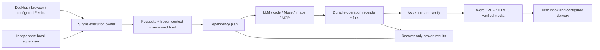

# ModelDesk 2.20 reliability release

Give ModelDesk a supported task, leave its interface, and receive verified files.
Requirements must survive revisions and restart. An unknown external result must
never become a second submission or a claimed success.

## Acceptance gates

- Durable checkpoints and one local execution owner; closing the interface does
  not stop the worker. A worker crash can be recovered under bounded supervision.
- Current Agent readiness is distinguished from saved configuration and old
  successful calls. A failed preflight explains the action needed before work.
- Original requests and artifacts remain intact. A versioned requirement brief
  and role-specific handoffs make active constraints and provenance inspectable.
- External operations have stable identity and receipts. Recovery collects an
  existing confirmed result; it does not repeat an unconfirmed dispatch.
- Task and result views remain readable at ordinary laptop widths; users can
  find progress, recovery actions, and requested real files.
- Repeatable tests cover revision continuity, restart, isolation, duplicate-call
  prevention, and actual document delivery. Fixtures are labeled separately from
  real provider acceptance.
- Rebuild and verify the packaged application, preserve existing data, update the
  README and safely finish Git after the acceptance gates pass.

## Boundaries

Adapters advertise their actual capabilities. Native Muse needs its Mac window
and authorization; a local worker cannot run while the Mac is asleep. Cloud
deployment is a separate extension. Feishu setup and local contract tests are
included, but tenant delivery cannot be certified without a configured app.
No new external permissions, paid subscriptions, or public deployment are implied.

## Implementation sequence

1. Durable local execution and truthful readiness.
2. External-operation reconciliation and structured task memory.
3. Task-focused presentation and outcome evaluations.
4. Real acceptance, packaging, documentation and Git completion.

## Interface direction

Retain the existing white/navy surface, indigo actions, jade success states and
system font. At 1600px and below, conversation and result are separate reading views;
wide screens retain the adjustable split. Long original prompts remain expandable
and copyable in full. Use dated status text and quiet dividers rather than more
badges or configuration panels. Reuse the existing Agent and task-center entry
points so users do not need another navigation system.

## Business flow and data objects

1. A user gives a project group a goal and the desired deliverable formats.
   Admission checks the selected connections and freezes member/tool/skill
   configuration. An unavailable required connection does not create a job.
2. The task retains each original instruction, later revision and prior artifact.
   A brief indexes these sources and the planner's interpretation. Each role gets
   the same brief version, its own work instruction, and actual dependency output.
3. The existing dependency runner executes supported adapters. It checkpoints
   dispatch before calling an external tool and records confirmed results and
   artifact hashes. Model prose is not an execution receipt.
4. Assembly produces the user-facing content. Review and mechanical file checks
   determine whether delivery is complete. Word, PDF and HTML are generated from
   that content; internal status remains in the task UI.
5. The background supervisor observes service health. Task recovery can resume
   model-only work and collect independently confirmed external results. An
   ambiguous external operation becomes actionable attention, never an automatic
   duplicate. Completion survives closing the desktop and remains in the inbox.

| Object | Responsibility | Code |
| --- | --- | --- |
| Task context | Full user requests, revision boundary, prior content and assets | `backend/task_context.py` |
| Task brief / role packet | Version, authoritative source references, pending items, requirement and dependency fingerprints | `backend/task_brief.py` |
| Job / checkpoint | Durable parent status and events; private atomic files, fsync, single worker ownership | `backend/workbench.py`, `backend/execution_store.py` |
| Operation receipt | Original member/task identity, prompt and output hashes, adapter capabilities, collection mode | `backend/agent_operations.py` |
| Recovery proof | Validate existing child/media/MCP records before reattaching; bounded original Muse observation | `backend/operation_recovery.py` |
| Readiness evidence | Timestamped connection/login/window checks, distinct from real generation evidence | `backend/readiness.py` |
| Supervisor | Existing local service controller, heartbeat, bounded restart window | `scripts/modeldesk_worker.py` |



## Repeatable verification

Run from the repository root with the configured local virtual environment:

```bash
# Backend, frontend behavior, lint and desktop checks; no paid provider call.
.venv/bin/python scripts/verify_modeldesk.py

# Focused restart, no-redispatch, context isolation and readiness contracts.
.venv/bin/python scripts/evaluate_reliability.py

# Explicit real provider acceptance. Creates labeled test resources and files.
# Requires a registered local MCP server allowing text_statistics and both models.
# Use a fresh output directory: existing evidence is never overwritten.
.venv/bin/python scripts/evaluate_reliability.py --live \
  --output data/acceptance-220/a-new-run

# Rebuild the frontend and signed macOS bundle.
.venv/bin/python scripts/package_modeldesk.py
```

The real benchmark checks the exact MCP input against returned character, word
and line counts, three numbered steps, a two-column/three-data-row table, the
selected source's tail marker, file bytes/types/hashes, requirement versions and
unchanged baseline text apart from the requested revision. It never retries a
submission after an uncertain POST. Failed acceptance leaves original jobs and
receipts available for inspection.

The desktop starts the supervisor automatically. For local service maintenance:

```bash
/usr/bin/python3 scripts/modeldesk_worker.py status
/usr/bin/python3 scripts/modeldesk_worker.py start
# Stops only the supervisor; existing services and tasks continue.
/usr/bin/python3 scripts/modeldesk_worker.py stop
```

Stop the supervisor first if deliberately stopping local services for maintenance;
otherwise its next health sweep will try to restore them. The supervisor is not
an OS login service and does not keep a sleeping or powered-off Mac executing.

## 2026-11-02 acceptance evidence

Evidence stays in ignored `data/acceptance-220/`; no user documents or credentials
are committed. Release checks distinguish real execution from deterministic tests.

| Gate | Observed result | Evidence |
| --- | --- | --- |
| Real heterogeneous collaboration | GPT author, local MCP counter, Gemini reviewer; two completed turns, one MCP dispatch per turn | `live/summary.json` |
| Revision continuity | Original goal, title, three steps, table and tail marker retained; only requested color and new actual counts changed | `live/independent-readback.json` |
| Actual deliverables | Six DOCX/PDF/HTML files parsed and matched to server hashes | `live/turn-1.*`, `live/turn-2.*` |
| Desktop independence | Desktop closed at 12:49:19 UTC; second task delivered at 12:51:29 UTC | `live/desktop-closed.json`, `live/independent-readback.json` |
| Service recovery | Deliberately stopped idle API restored in 4.07 seconds; original jobs and single-dispatch receipts unchanged | `supervisor-recovery.json` |
| Assembly recovery and clean output | Third real turn automatically resumed assembly once; removed internal-review boilerplate, delivered three parsed files, still one MCP dispatch | `live/cleanup-readback.json`, `live/final.*` |
| Duplicate worker | A second real API process exited before startup recovery; all 15 existing code-Agent checkpoints unchanged | `duplicate-worker.json` |
| Parent loss after tool completion | Fault injection recovers the saved MCP receipt, finishes downstream work and HTML without another tool call | `backend/test_autonomy.py` |
| Native observation | Tests cover acknowledged Muse observation once, waiting-user/unknown/stopped rejection, and no submit | `backend/test_group_delivery_runtime.py` |
| UI | Laptop result reading view, original/revision memory dialog, phone-width inbox and actual PDF download | `ui/`, local downloaded PDF |

Muse's window readiness is a current local check, not a new cloud-video benchmark.
Claude Code requires its own authenticated login. The saved simulated API fixture
was unreachable and correctly displayed as failed. Grok Bot has no native adapter
in this release; a configured xAI model endpoint is a separate capability. Feishu
transport contracts are tested locally, but no unconfigured tenant delivery is
claimed. Requirements retain the existing explicit 60,000-character ceiling;
working context and individual adapter limits remain bounded.
